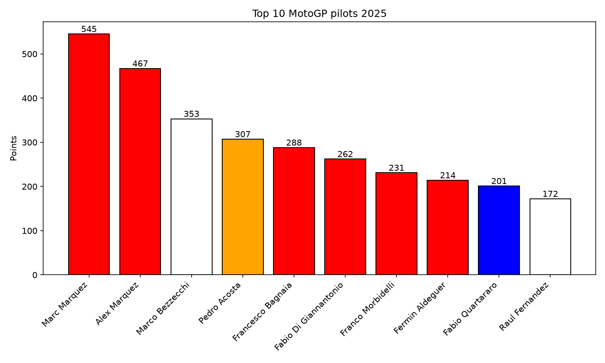
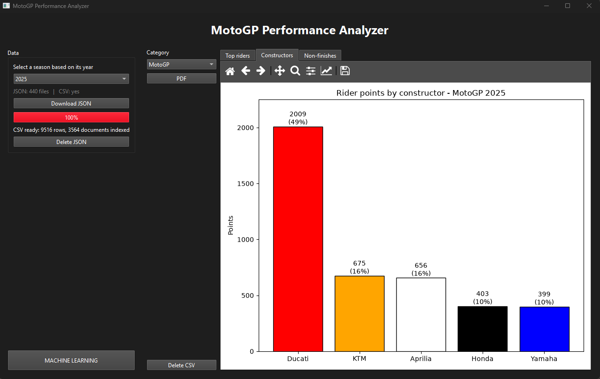
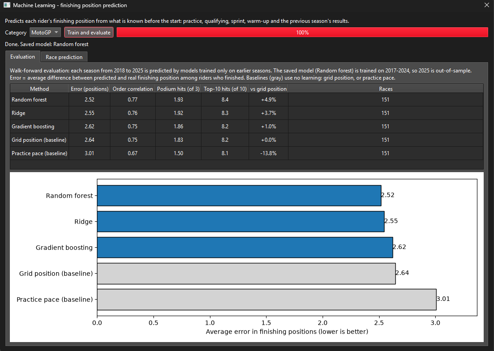
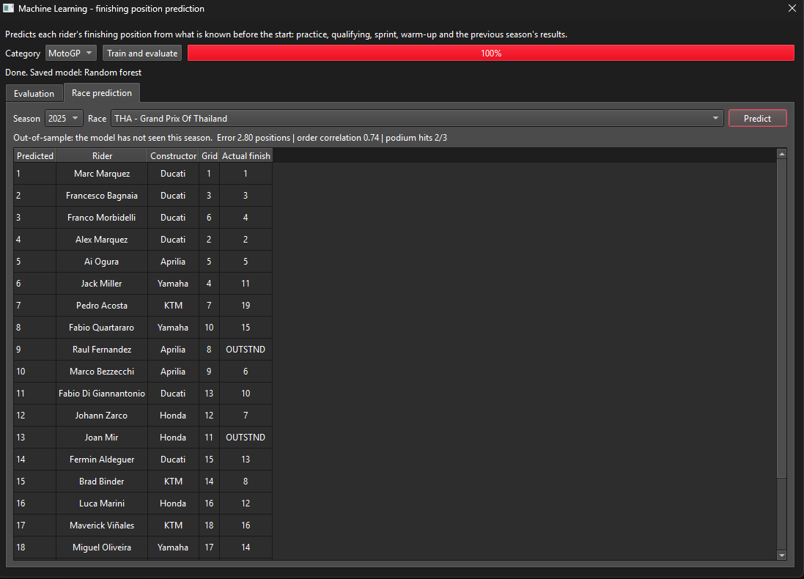

# 🏍️ MotoGP Performance Analyzer 🏍️

Desktop application to download, clean, visualize and model public MotoGP results data, built in Python as a data analysis and machine learning portfolio project.





---

## 📌 Overview

MotoGP Performance Analyzer collects public results data (seasons from 1949 to today, older seasons have limited data), turns it into clean tables with Pandas and shows rider, constructor and reliability charts in a desktop application.

A machine learning module predicts each rider's finishing position from information available before the race, and compares the models with strong baselines.

---

## ✨ Features

- Season selector from the current year back to 1949
- Parallel download with progress bar, cancel button, automatic retries and resume (files already downloaded are skipped)
- One-click conversion of the raw JSON files into a clean CSV
- Three charts for each category (MotoGP, Moto2, Moto3):
  - top riders by points, coloured by constructor
  - points by constructor
  - race non-finishes by team
- Official session documents (classifications, analysis, ...) opened on demand from the official website
- Local data management: delete the JSON or CSV files of one season, or of all seasons
- Machine learning window: train and evaluate the models, and compare the predicted finishing order with the real result of any downloaded race

---

## 🎯 Objectives

- [x] Collect public MotoGP data through an API
- [x] Clean and transform raw data using Pandas
- [x] Analyze rider, constructor and team performance
- [x] Create meaningful data visualizations
- [x] Build a desktop application to explore the results
- [x] Develop machine learning models for performance prediction
- [ ] Identify performance patterns across circuits and races
- [ ] Predict non-finishes (crashes and technical failures)

---

## 🛠️ Technologies

- Python 3.12 (3.11 to 3.13 work too)
- PySide6 (desktop interface)
- Pandas and NumPy (data cleaning and analysis)
- Matplotlib (charts)
- Scikit-learn (machine learning models and evaluation)
- Requests (API access, with parallel downloads)
- Git & GitHub

---

## 🚀 Getting started

### Windows

1. Get the project: on GitHub click **Code → Download ZIP** and extract it (or clone the repository). Any folder works; a short path such as `C:\MotoGP` is the simplest.
2. Double-click `start.bat`.
   - If Python 3.11 to 3.13 is missing, `start.bat` offers to install Python 3.12 for you. You can also install it yourself from [python.org](https://www.python.org/downloads/), ticking **Add python.exe to PATH** in the installer.
   - The first run creates a virtual environment and installs the libraries. It can take a few minutes, PySide6 is a large download. Later runs start immediately.
3. If Windows shows a protection warning ("Windows protected your PC"), click **More info → Run anyway**.

The libraries are installed in `%LOCALAPPDATA%\MotoGPAnalyzer`, outside the project. Delete that folder to uninstall them.

### Using the app

1. Choose a season in the left panel and press **Download JSON**.
2. When the download finishes, press **Convert JSON to CSV**.
3. Pick a category and explore the charts. The **PDF** button opens the official documents of a session.
4. Press **MACHINE LEARNING** to train and evaluate the prediction models. Download several seasons first: the evaluation needs at least two to be reliable.

The `data/` folders are created automatically on first use and are not versioned.

### Other systems (not tested)

`start.bat` is Windows-only. On other systems you can run the app from source:

```bash
python -m venv .venv
# activate the virtual environment, then:
pip install -r requirements.txt
python src/app/main.py
```

---

## 🧭 How it works

```text
MotoGP API  →  JSON files  →  Pandas cleaning  →  CSV files  →  charts in the app
               data/raw/<year>/                  data/processed/
```

- Downloads use up to 4 parallel requests with short delays and automatic retries.
- Each session is saved as one JSON file; the CSV of a season is built from all of them.

### Data cleaning decisions

- Test sessions and the MotoE category are excluded.
- `session_number` is missing for sessions without a number (practice, warm-up, sprint, race) and is kept as a real missing value.
- `position` is a nullable integer: riders who did not finish have no position.
- Speeds equal to `0` mean "not available" and become missing values.
- `best_lap_seconds` is parsed from the `MM:SS.mmm` text format.
- `points` stays a decimal number because shortened races award half points.

---

## 🤖 Machine learning





**Task:** predict the finishing position of each rider in a race, using only information available before the start.

```text
clean CSVs  →  feature table  →  models vs baselines  →  saved model  →  race prediction
(one row per rider per race)    (walk-forward evaluation)
```

**Features** (built in `src/ml/features.py`):

- grid position, derived from the Q1 and Q2 results
- gap (%) to the fastest lap in qualifying, in the combined practice sessions, and in each practice session and the warm-up
- sprint result (from 2023)
- top speed relative to the fastest bike of the weekend
- average finishing position of the rider and of the constructor in the previous season

Only sessions that take place before the race are used.

**Models:** Ridge regression, Random forest and Gradient boosting, compared with two baselines that learn nothing: the *grid position* and the *practice pace*. The grid position alone is already a strong predictor, so a model is only useful if it beats it.

**Evaluation:** walk-forward by season. Each season is predicted by models trained only on earlier seasons, so a model never sees the future. With a single season the app falls back to cross-validation by race, which is indicative only. Metrics are computed race by race on the riders who finished:

- average error in finishing positions
- rank correlation (Spearman) between predicted and real order
- podium hits (out of 3) and top-10 hits (out of 10)

**Run it:**

- from the app: **MACHINE LEARNING** → *Train and evaluate*, then the *Race prediction* tab to compare the predicted order with the real result of a race
- from the terminal, in the project folder: `python src/ml/train.py --category MotoGP` (also `Moto2` and `Moto3`)

The best model is saved in `data/models/` (not versioned). Model files are Python pickles: only load files you trained yourself.

<!-- TODO: after running "Train and evaluate" on your seasons, add a "Results" section with the table: method, error (positions), order correlation, podium hits, improvement over the grid baseline. If the models do not clearly beat the grid baseline, say so: it is a valid result. -->

---

## 📂 Project Structure

```text
motogp-performance-analyzer/
│
├── src/
│   ├── app/                  # desktop application (PySide6)
│   │   ├── main.py           # entry point
│   │   ├── main_window.py    # main window
│   │   ├── collector.py      # parallel download of the JSON files
│   │   ├── processor.py      # JSON → clean CSV
│   │   ├── ml_window.py      # machine learning window
│   │   └── ...               # PDF viewer, storage, settings
│   ├── ml/                   # machine learning
│   │   ├── features.py       # feature table
│   │   ├── models.py         # models
│   │   ├── evaluation.py     # metrics and walk-forward evaluation
│   │   ├── train.py          # train, evaluate and save the best model
│   │   └── predict.py        # race prediction
│   └── visualization/
│       └── charts.py         # chart functions (Matplotlib)
│
├── docs/                     # app screenshot
├── visualizations/           # example charts (PNG)
├── data/                     # created automatically, not versioned
│   ├── raw/                  # downloaded JSON files
│   ├── processed/            # clean CSV files
│   └── models/               # saved machine learning models
│
├── start.bat                 # one-click launcher (Windows)
├── requirements.txt
└── README.md
```

---

## ⚠️ Data source and disclaimer

- Data comes from an undocumented API used by the official MotoGP website. It is unofficial and may change or stop working without notice.
- This is an educational, non-commercial portfolio project, not affiliated with or endorsed by MotoGP or its rights holders.
- All data and documents belong to their rights holders. Downloaded files stay on your computer and are not part of this repository. Official PDF documents are opened from the official website on demand.

---

## 🚧 Known limitations

- Seasons before 2002 have limited data: some charts may be empty.
- "Constructors" shows the sum of all riders' points per manufacturer, not the official constructors' standings.
- Non-finishes are absolute counts: teams with more riders have more chances to appear.
- Only finished events are downloaded, so race predictions are backtests on past races: upcoming races cannot be predicted.
- The grid position is derived from the qualifying results: grid penalties are not known.
- The models predict the finishing order of riders who finish: crashes and technical failures are not predicted.
- With few seasons the machine learning results are indicative only, and the improvement over the grid baseline can be small.
